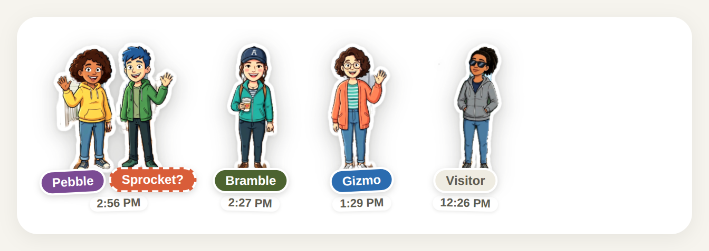

# Frigate Cutouts Card

A Home Assistant Lovelace card (HACS-compatible) that displays recent **Frigate** `person` detections as **die-cut stickers** using browser-side **MediaPipe Selfie Segmentation**, complete with:

* **In-browser background removal + white sticker outline** (cached in IndexedDB per event + settings)
* **Adaptive brightness & contrast** for dim porch shots, with automatic fallback to a rounded white-bordered frame on dark night/IR shots
* **5-minute person deduping** (treats unlabeled detections within the same camera's 5-minute window as the same person, preferring recognized `sub_label`s)
* **Tap any sticker** to view the full uncropped snapshot
* **Visual UI Card Editor** for all parameters (`instance_id`, `cameras`, `limit`, `dedupe_minutes`, `threshold`, `outline_px`, `target_luminance`, `contrast`, `tilt`, `unknown_label`)

## Installation via HACS / Marketplace

1. In Home Assistant, open **Settings → Marketplace → ⋮ → Custom repositories** (or **Add from link**).
2. Paste `https://github.com/reedlabotz/frigate-cutouts-card` and choose category **Dashboard** (`plugin`).
3. Install **Frigate Cutouts Card** and refresh your browser (or **Settings → Companion App → Reset frontend cache** on mobile).
4. Add a **Frigate Cutouts Card** from the dashboard card picker (or in YAML with `type: custom:frigate-cutouts-card`).
